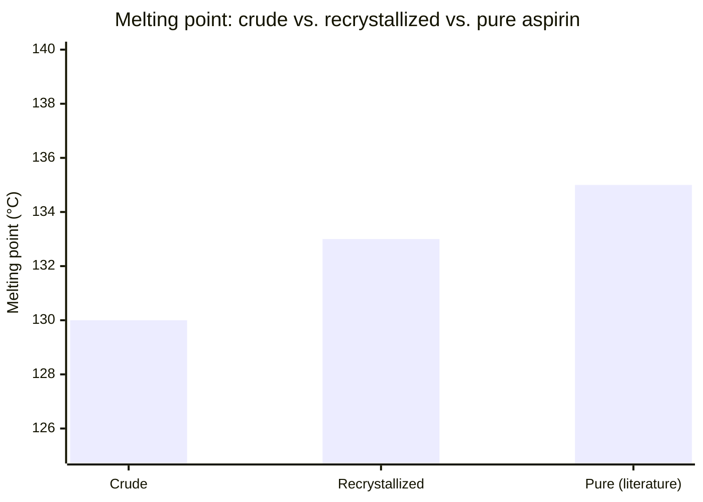
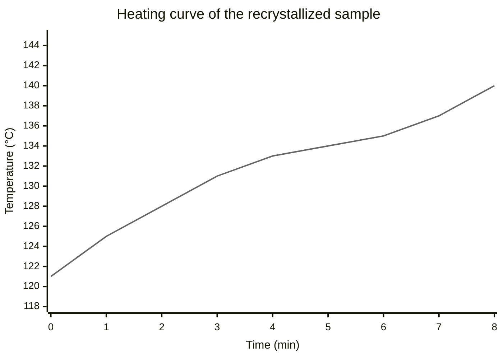

**Note**: The rendered look of this file might not be correct if you view it in
any other Markdown viewer than `Markdown Viewditor` because it uses extensions to
Markdown that not all Markdown viewers can render correct and beautiful.

# Synthesis of Aspirin (Acetylsalicylic Acid)

**Name:** Emma Sørensen · **Class:** 2.y · **Date:** 12 May 2026

## Aim

The goal of this experiment was to make aspirin (acetylsalicylic acid) from
salicylic acid and acetic anhydride, to calculate our percentage yield, and to
check how pure our product was by measuring its melting point.

## Theory

Aspirin is made by a reaction where the \(\ce{OH}\) group on salicylic acid
gets an acetyl group from acetic anhydride. The reaction is catalyzed by
sulfuric acid, \(\ce{H2SO4}\):

\[
\ce{C7H6O3 + C4H6O3 ->[H2SO4] C9H8O4 + CH3COOH}
\]

The three organic molecules we worked with:

Salicylic acid — the starting material (also the stuff in willow bark that
people used against pain long ago):

```smiles
OC(=O)c1ccccc1O
```

Acetic anhydride — the reagent that adds the acetyl group:

```smiles
CC(=O)OC(=O)C
```

Aspirin — our product, acetylsalicylic acid:

```smiles
CC(=O)Oc1ccccc1C(=O)O
```

The second product is acetic acid, \(\ce{CH3COOH}\), which is why everything
in the lab smelled like vinegar during the experiment.

If we know the mass \(m\) and the molar mass \(M\) of a substance, the amount
of substance is:

\[
n = \frac{m}{M}
\]

Salicylic acid is the limiting reagent, so the theoretical yield of aspirin
follows from the reaction equation. The percentage yield is:

\[
\text{yield} = \frac{m_\text{product}}{m_\text{theoretical}} \times 100\,\%
\]

## Materials and Apparatus

- Salicylic acid, \(\pu{2.00 g}\)
- Acetic anhydride, \(\pu{3.0 mL}\) (in the fume hood — it smells very strong!)
- Concentrated sulfuric acid, \(\ce{H2SO4}\), 5 drops as catalyst
- Distilled water and ice for the ice bath
- Sodium bicarbonate solution, \(\ce{NaHCO3}\)
- Conical flask, beaker, water bath, filter funnel and filter paper
- Balance (0.01 g), thermometer, melting point apparatus

## Procedure

1. Weigh \(\pu{2.00 g}\) of salicylic acid into the conical flask.
2. In the fume hood, add \(\pu{3.0 mL}\) of acetic anhydride and then, very
   carefully, 5 drops of concentrated \(\ce{H2SO4}\).
3. Heat the flask in a water bath at about \(85\,^\circ\mathrm{C}\) for
   15 minutes and swirl a few times.
4. Take the flask out and slowly add \(\pu{20 mL}\) of cold water — this
   destroys the excess acetic anhydride and the mixture gets warm.
5. Cool the flask in an ice bath and scratch the inside of the flask with a
   glass rod to start the crystallization.
6. Filter the crystals on the filter paper and wash them with a little cold
   water. Then wash with a small amount of \(\ce{NaHCO3}\) solution.
7. Recrystallize the product from a small amount of ethanol/water and let it
   dry on the filter paper.
8. Weigh the dry crystals and measure the melting range in the melting point
   apparatus.

## Observations

| Step | What we saw, felt or smelled                                            |
| ---- | ----------------------------------------------------------------------- |
| 2-3  | Strong smell of vinegar (acetic acid) during heating                     |
| 4    | White solid started to appear when the cold water was added              |
| 5    | Snow-white crystals grew after we scratched the flask                    |
| 6    | Clear fizzing (bubbles of \(\ce{CO2}\)) when we washed with \(\ce{NaHCO3}\) |
| 7-8  | Dried product: fine white crystals with a slight "medicine" smell        |

## Results and Calculations

| What                       | Value                  |
| -------------------------- | ---------------------- |
| Mass of salicylic acid     | \(\pu{2.00 g}\)        |
| Molar mass, salicylic acid | \(\pu{138.12 g/mol}\)  |
| Mass of dry aspirin        | \(\pu{2.13 g}\)        |
| Molar mass, aspirin        | \(\pu{180.16 g/mol}\)  |

Amount of salicylic acid (limiting reagent):

\[
n = \frac{m}{M} = \frac{\pu{2.00 g}}{\pu{138.12 g/mol}} = \pu{0.0145 mol}
\]

Theoretical yield of aspirin (1:1 from the equation):

\[
m_\text{theoretical} = n \times M = \pu{0.0145 mol} \times \pu{180.16 g/mol} = \pu{2.61 g}
\]

Percentage yield:

\[
\text{yield} = \frac{m_\text{product}}{m_\text{theoretical}} \times 100\,\%
= \frac{\pu{2.13 g}}{\pu{2.61 g}} \times 100\,\% = 81.6\,\%
\]

## Melting Point Test

Pure aspirin melts at about \(T_\text{melt} = 135\,^\circ\mathrm{C}\). We
measured both our crude product (before recrystallization) and the
recrystallized product. A melting range that is lower and wider than the
literature value means the product is not completely pure.



The recrystallized sample melted over the range \(132\) -
\(134\,^\circ\mathrm{C}\). The heating curve from the melting point apparatus
shows the plateau where the crystals actually melt:



## Discussion

Our yield of \(81.6\,\%\) is okay but not amazing. I think we lost some
product in the filtering step — some crystals stayed dissolved in the
water/ethanol and did not all come out in the ice bath. If we had used less
solvent for the recrystallization, the yield would probably have been better.

The melting point of the recrystallized product
(\(132\) - \(134\,^\circ\mathrm{C}\)) is closer to the literature value than
the crude product (\(128\) - \(131\,^\circ\mathrm{C}\)). The lower and wider
range of the crude product is probably because it still contained some
salicylic acid and water. This means the recrystallization really did
improve the purity, which is exactly what it is supposed to do.

One thing we could have done better: we did not dry the crystals completely
before weighing them, so our measured mass might be a little too high — or
maybe the yield was even worse than 81.6 %, who knows.

## Conclusion

We successfully synthesized aspirin from salicylic acid and acetic anhydride
and got a yield of \(81.6\,\%\). The melting point test showed that
recrystallization made the product more pure, since the melting range moved
closer to the literature value of \(135\,^\circ\mathrm{C}\).

## References

1. Our chemistry textbook, chapter 9: organic reactions and esters.
2. [PubChem: Aspirin](https://pubchem.ncbi.nlm.nih.gov/compound/2244) —
   molar mass and melting point data.
