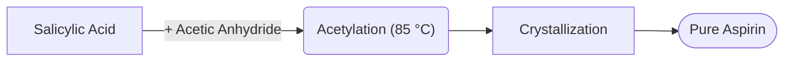

# Aspirin: Synthesis & Kinetics {#aspirin}

**Acetylsalicylic acid** ($\ce{C9H8O4}$, $M = \pu{180.16 g/mol}$) is made by _acid-catalyzed esterification_, replacing ~~crude willow-bark extracts~~ with a ==pure crystalline analgesic==.[^1]

$$\ce{C7H6O3 + (CH3CO)2O ->[\ce{H2SO4}][\pu{85 °C}] C9H8O4 + CH3COOH} \qquad \Delta H^\circ = \pu{-39.5 kJ/mol}$$

```smiles {scale=0.75}
CC(=O)Oc1ccccc1C(=O)O
```

## Process & Reaction Kinetics



Conversion follows pseudo-first-order kinetics with Arrhenius rate constant $k(T)$:

$$X(t) = 1 - e^{-kt}, \qquad k(T) = A \exp\!\left(-\frac{E_a}{RT}\right)$$

```vega-lite
{"width": 380, "height": 105,
 "data": {"values": [{"t":0,"y":0},{"t":3,"y":42},{"t":6,"y":65},{"t":9,"y":76},{"t":12,"y":82},{"t":15,"y":85}]},
 "mark": {"type": "line", "point": true, "interpolate": "monotone"},
 "encoding": {
   "x": {"field": "t", "type": "quantitative", "title": "Reaction time $t$ (min)"},
   "y": {"field": "y", "type": "quantitative", "title": "Yield $\\eta$ (%)"}
 }}
```

## Compound Properties & Quality Checklist {#properties}

| Compound          | Formula        | Molar Mass ($\pu{g/mol}$) | Melting Point |
| :---------------- | :------------: | ------------------------: | ------------: |
| Salicylic acid    | $\ce{C7H6O3}$  |                    138.12 |        159 °C |
| Acetic anhydride  | $\ce{C4H6O3}$  |                    102.09 |        −73 °C |
| **Aspirin**       | $\ce{C9H8O4}$  |                **180.16** |    **135 °C** |

- [x] Verify purity via melting range ($134\text{–}135\,^\circ\mathrm{C}$) and log with <kbd>Ctrl</kbd>+<kbd>S</kbd>
- [ ] Run ferric chloride ($\ce{FeCl3}$) test for residual phenol groups

```python
def theoretical_yield(salicylic_g: float) -> float:
    """Theoretical aspirin yield (g) from salicylic acid mass (g)."""
    return (salicylic_g / 138.12) * 180.16
```

[^1]: First synthesized in pure stable form by Felix Hoffmann in 1897; see [PubChem CID 2244](https://pubchem.ncbi.nlm.nih.gov/compound/2244).
